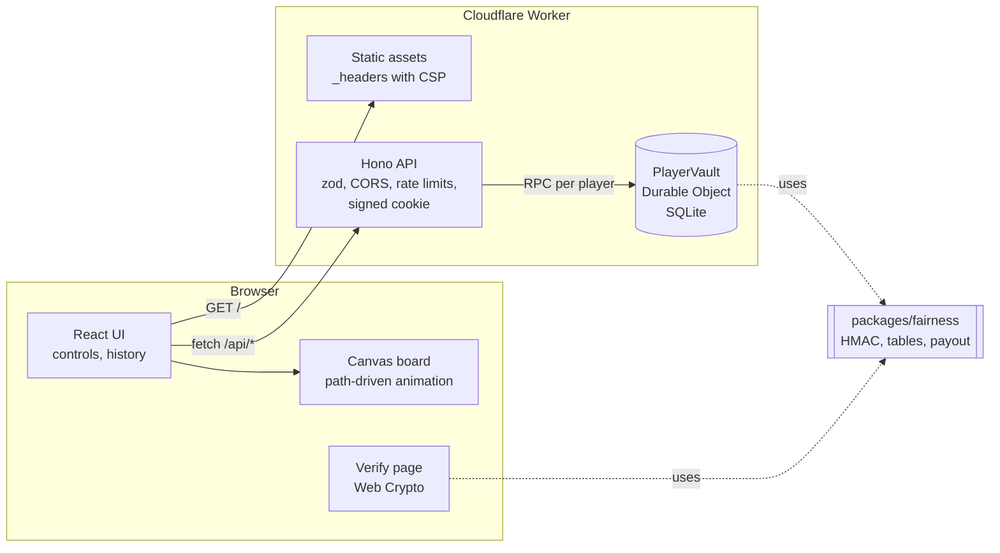
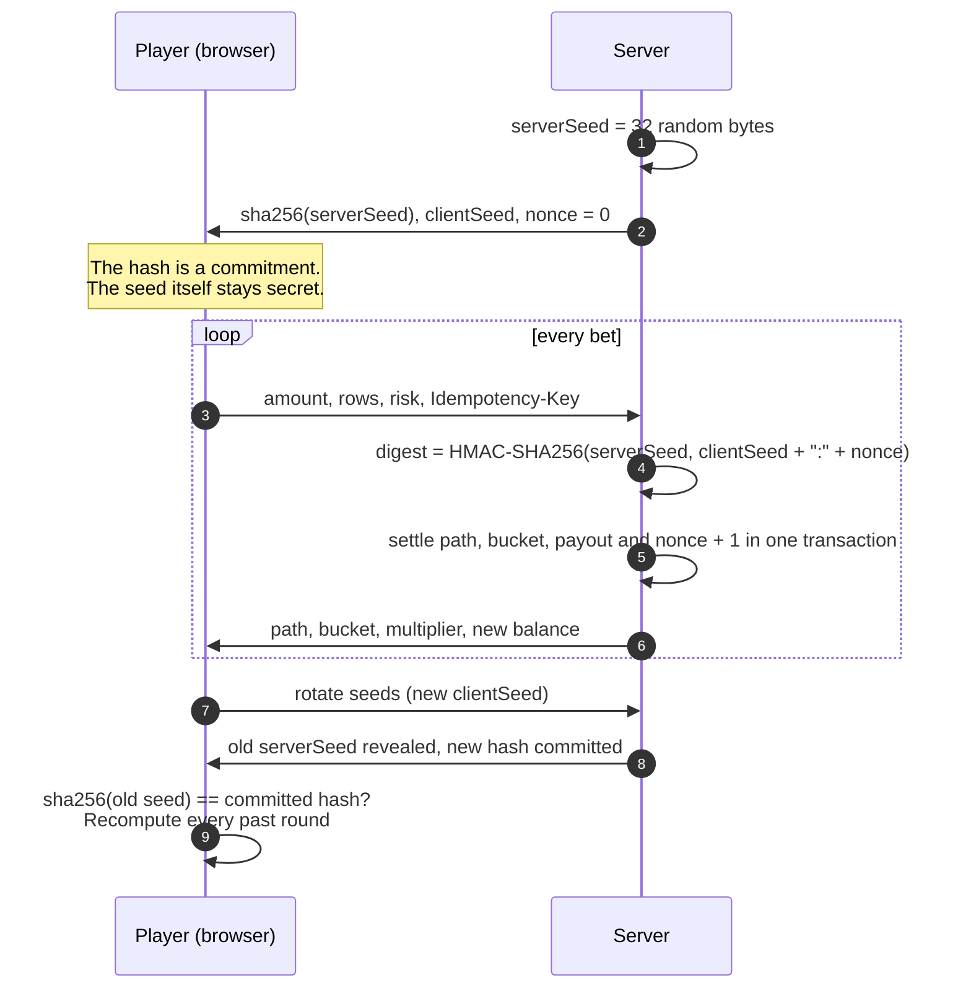
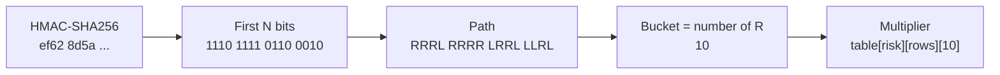

# Drop-Win

A provably fair ball-drop game where every result is committed before you bet and can be re-checked in your browser.


**Live demo:** not deployed yet. The [deploy guide](#deploy) gets it running on Cloudflare's free tier in a few commands.

**Play money only.** Balances are pretend dollars with no value. There are no deposits, withdrawals, payments, real-money or crypto features, and none are planned.

## Contents

- [How it works](#how-it-works)
- [The math](#the-math)
- [Verify a round yourself](#verify-a-round-yourself)
- [Design decisions](#design-decisions)
- [Security notes](#security-notes)
- [Running locally](#running-locally)
- [Testing](#testing)
- [Deploy](#deploy)
- [Project structure](#project-structure)
- [Limitations and next steps](#limitations-and-next-steps)
- [Credits](#credits)
- [License](#license)

## How it works

The server decides each drop with a keyed hash of secrets it committed to earlier. The browser receives the left/right path and animates the ball along exactly that path, so the picture and the payout always agree.

### Architecture



One Worker serves both the built web app and `/api/*`. Each player is a Durable Object with its own SQLite database. The same Hono app and ledger also run on plain Node with `node:sqlite`, which is what local development, the tests and the end-to-end suite use.

### Commit and reveal



The server cannot change the outcome after the fact, because the seed was fixed by its hash before the first bet. It cannot pick a seed that suits your bets either, because the result also depends on your client seed, which you can set to anything when rotating.

### From digest to bucket



Bits are read most significant first within each byte, one per row. A `1` bounces right and a `0` bounces left. After `N` rows the ball sits in bucket `k`, the count of right bounces, from `0` (far left) to `N` (far right). Changing the row count only changes how many bits are read.

The animation is not a physics simulation. Given the path, the ball falls onto the top of exactly one peg per row (the peg at index `rights + 1` in that row), hops half a peg spacing left or right on a parabola with an eased sideways kick, and comes to rest in the bucket. Tests check that all 256 eight-row paths and 1,500 random 9- to 16-row paths land in the bucket the server named, that the ball touches the right peg on every row, and that sampled trajectories never pass through a peg.

## The math

### Bucket probabilities

Each row is an independent fair coin, so the bucket follows a binomial distribution:

$$P(k) = \binom{N}{k} \Big/ 2^N, \qquad k = 0, \dots, N,\quad N \in \{8, \dots, 16\}$$

### Multiplier tables

Every table is built from one formula with two knobs per risk level:

$$m_k = f + b\left(P(k)^{-\alpha} - P_{\max}^{-\alpha}\right)$$

- `f` (the floor) is what the most likely bucket pays.
- `α` (the tail) controls how much rarity is rewarded. With `α = 1` every bucket would contribute equally to the expected return.
- `b` is solved in closed form so that the expected return hits the target exactly:

$$\sum_k P(k)\, m_k = \text{RTP} \;\Rightarrow\; b = \frac{\text{RTP} - f}{\sum_k P(k)\left(P(k)^{-\alpha} - P_{\max}^{-\alpha}\right)}$$

| Risk   | Floor `f` | Tail `α` | 8 rows edge | 16 rows edge | 16-row centre |
| ------ | --------- | -------- | ----------- | ------------ | ------------- |
| Low    | 0.5x      | 0.40     | 8.94x       | 76.7x        | 0.5x          |
| Medium | 0.3x      | 0.60     | 17.3x       | 373x         | 0.3x          |
| High   | 0.2x      | 0.75     | 25.2x       | 1085x        | 0.2x          |

The target RTP (return to player) is 99%. The ideal values are then rounded to what a player expects to read: hundredths below 10x, tenths below 100x, whole numbers above. Rounding pushes the RTP slightly off target, so a small exhaustive search nudges the four rings of buckets nearest the centre (they hold most of the probability) by a few display steps and keeps the table closest to 99% that is still symmetric and rises toward the edges.

`packages/fairness/scripts/tables.ts` generates `tables.generated.ts` and fails if any table is off target or if the committed file is stale. RTP is computed exactly with integers: `sum(C(N,k) * m_k) / (100 * 2^N)`, with multipliers stored in hundredths.

**Result:** all 27 tables (9 row counts by 3 risks) are within 0.0088 percentage points of 99%. The test tolerance is 0.01 points. Higher risk has strictly higher variance at every row count, which is also tested.

### Does the RNG really produce that distribution?

A test drops 100,000 balls with fixed seeds through the real derivation and runs Pearson's chi-square test against the binomial distribution (edge buckets pooled until every group expects at least 5 hits):

| Rows | χ²    | Degrees of freedom | Critical value (p = 0.001) | p-value |
| ---- | ----- | ------------------ | -------------------------- | ------- |
| 8    | 7.51  | 8                  | 26.12                      | 0.48    |
| 16   | 17.37 | 14                 | 36.12                      | 0.24    |

The seeds are fixed so the test can never flake. `node packages/fairness/scripts/simulate.ts` repeats this for every row count with a fresh random seed and also prints simulated RTP next to the exact figure. Simulated RTP at 16 rows and high risk wanders by a couple of points over 100k drops, which is expected when one bucket in 65,536 pays 1085x.

### Money

All balances and bets are integer cents. Multipliers are integer hundredths. A payout is `floor(amountCents * multiplierHundredths / 100)`, the only rounding step, and it always rounds in the house's favour by less than one cent. The bet input is parsed with string arithmetic so `0.1 + 0.2` style float errors cannot appear.

## Verify a round yourself

**In the app.** Open the history, click **Reveal and rotate seeds**, then click **Verify** on any earlier bet. The verify page recomputes the round with your browser's Web Crypto, checks that `sha256(serverSeed)` equals the hash you were shown before betting, and confirms the path and multiplier match what was paid. Nothing is sent to the server, and the page works for any values you paste in.


**Without this code.** Any HMAC tool gives the same answer. With the server seed, client seed and nonce from a revealed bet:

```sh
SERVER_SEED=a3f1c5e9d2b8470e96c3f0a1b2d4e6f8091a2b3c4d5e6f708192a3b4c5d6e7f8
CLIENT_SEED=player-seed
NONCE=0

# 1. The seed matches the commitment you saw before betting
printf '%s' "$SERVER_SEED" | shasum -a 256
# 614f4563ca0b64da228859760dbf293416d20592ae5f5582012f83eb78cad6ad

# 2. The round's digest
printf '%s' "$CLIENT_SEED:$NONCE" | openssl dgst -sha256 -hmac "$SERVER_SEED"
# ef628d5ae6bdb951de0b2596bb5d9dd669b86feb0f30eba43a42ae8d6310f6e7
```

`ef 62` in binary is `11101111 01100010`. For 16 rows that is the path `RRRLRRRRLRRLLLRL`, ten right bounces, bucket 10, which pays 0.68x at medium risk. These exact values are a test vector in `packages/fairness/test/outcome.test.ts`.

## Design decisions

**Path-driven animation instead of physics.** The old version simulated physics and looked up which starting position would probably reach the chosen bucket. After the physics constants changed, only about one ball in ten landed where the server said. Here the server's bits are the path, and the animation is a pure function of `(path, elapsed time, board width)`. There is nothing to drift out of sync, resizing mid-drop is harmless, and reduced motion is just "elapsed = end".

**Cloudflare Workers and Durable Objects over Node plus a hosted database.** A Durable Object gives each player a single-threaded actor with its own SQLite database, which is exactly the consistency model a balance needs, and it is available on the Workers free plan. Hosting the web app as static assets on the same Worker keeps the session cookie first-party, which avoids third-party cookie blocking and allows `SameSite=Strict`.

**One ledger, two runtimes.** The ledger talks to a three-method synchronous SQL interface. `node:sqlite` and Durable Object storage are both synchronous, so a transaction is a plain function call. That let the API tests run against real SQLite in Node in under a second, without a Workers test harness, while production uses the same code inside the Durable Object.

**Bets are serialized per player, then settled in one transaction.** The HMAC uses async Web Crypto, so two concurrent requests could both read nonce N. Each player's bets go through an in-memory queue (exact in a Durable Object, which runs one instance per player), then the debit, credit, nonce increment and history row are written in a single transaction that re-checks the nonce. A database `CHECK` keeps balances non-negative even if application code were wrong. A test fires 30 concurrent bets and checks the nonces are exactly 0 to 29.

**Idempotency keys.** Every bet carries a UUID `Idempotency-Key`. The client retries once on a dropped connection with the same key, and the server replays the stored result instead of charging twice. Reusing a key for a different bet is a 409.

**Shared fairness package.** `packages/fairness` holds the outcome derivation and tables, and is imported by both the server and the verifier page. The verifier is still an independent check of the server's honesty because it recomputes from public inputs. Web Crypto results are tested against Node's `crypto` module and against openssl test vectors.

**Displayed balance lags the server on purpose.** The server's balance already includes the payout of a ball that is still falling. The UI subtracts in-flight payouts so the number only moves when a ball lands, and ignores late responses that would roll the balance back.

**React, no router, no CSS framework.** Two pages do not need a router, so routing is a hash listener and a switch. Plain CSS with custom properties covers dark and light themes. The production bundle is 88 KB of gzipped JavaScript, most of it React DOM.

**TypeScript 6.0 rather than 7.** TypeScript 7 (the native compiler) is out, but typescript-eslint's type-aware rules only support up to 6.0, and those rules are worth more here than a faster compiler.

## Security notes

- **Seeds.** Server seeds are 32 bytes from the platform CSPRNG. The active seed is never sent to a client; only its SHA-256 hash is. Tests check that the active seed appears in no state, bet or history response.
- **Validation at every boundary.** Request bodies, the `Idempotency-Key` header, query strings, the session cookie value, environment variables and verify-page URL parameters are parsed with zod. Request schemas are strict, so a client-supplied field like `multiplier` is rejected rather than ignored. The web client also parses every API response.
- **Sessions.** An anonymous random UUID in an HMAC-signed, `HttpOnly`, `SameSite=Strict` cookie, `Secure` with the `__Host-` prefix in production. Signing means a forged id is rejected before any storage is touched, which also stops anyone spinning up arbitrary Durable Objects.
- **CSRF and CORS.** POST requests must be `application/json` (a cross-site form cannot send that without a preflight) and must come from the same origin or a configured one. CORS answers only configured origins.
- **Rate limits and size limits.** Per-IP limits for all API calls and for new sessions, a per-player limit on bets, and a 2 KB body limit. Node uses an in-memory fixed window with bounded memory; the Worker uses Cloudflare's rate limiting binding with the same numbers (a test checks they match).
- **Headers.** The web app ships a strict CSP (`script-src 'self'`, no inline scripts or styles, `frame-ancestors 'none'`), HSTS, `nosniff`, `Referrer-Policy: no-referrer` and a restrictive `Permissions-Policy`. The end-to-end test runs under that policy and fails on any console error. API responses carry `default-src 'none'` and `Cache-Control: no-store`.
- **Errors.** Unexpected errors return a generic message; details go to server logs only.
- **Supply chain.** Dependencies are pinned, `npm audit --omit=dev` runs in CI, CodeQL scans on every push and weekly, Dependabot updates npm packages and GitHub Actions, and all actions are pinned to full commit SHAs with `contents: read` permissions.

See [SECURITY.md](SECURITY.md) for how to report a problem.

## Running locally

Requires Node 24 or newer.

```sh
git clone https://github.com/shashank11yadav/Drop-Win.git
cd Drop-Win
npm ci
npm run dev
```

Open http://localhost:5300. `npm run dev` starts the API on port 5301 (Node, SQLite file in `apps/api/data/`) and Vite on 5300, which proxies `/api` to it. Without a `.env` the API generates a throwaway session secret; to keep sessions across restarts, `cp .env.example .env` and set `SESSION_SECRET` (`openssl rand -hex 32`).

Other ways to run it:

| Command                                      | What it does                                                                                          |
| -------------------------------------------- | ----------------------------------------------------------------------------------------------------- |
| `npm start`                                  | Builds the web app and serves it and the API from one Node process on 5301.                           |
| `npm run build`                              | Builds the web app and bundles the Worker (`wrangler deploy --dry-run`).                              |
| `npm run dev:worker -w @drop-win/api`        | Runs the real Worker and Durable Object locally with Wrangler on port 5302 (build the web app first). |
| `node packages/fairness/scripts/simulate.ts` | Prints chi-square and simulated RTP for every row count.                                              |
| `npm run tables -w @drop-win/fairness`       | Regenerates the multiplier tables.                                                                    |

All environment variables are documented in [.env.example](.env.example).

## Testing

```sh
npm run lint          # ESLint (strict type-checked rules) and Prettier
npm run typecheck     # tsc for every workspace, including the Worker
npm test              # Vitest: fairness, contract, API and web projects
npm run tables:check  # tables match the generator and the RTP target
npm run e2e           # Playwright, desktop and phone
```

What the 272 unit and integration tests cover:

- **Fairness:** openssl test vectors, Web Crypto against `node:crypto` on 500 random inputs, bit order, input validation, chi-square over 100k drops, RTP of every table, table shape, and that the committed tables match the generator.
- **API:** invalid bets rejected (zero, negative, fractional, too large, wrong types, unknown fields, bad rows or risk), balance never negative under concurrency, nonce increments once per bet, idempotent replay, seed rotation reveals the committed seed and every past round verifies, cookie tampering, CORS and origin checks, content type and body size, rate limits, security headers, and hidden internal errors.
- **Web:** every 8-row path lands in the right bucket, peg contact and clearance, layout at 343 px, money parsing, verify-link parsing (including hostile input), the game state reducer, and WCAG contrast for every theme token and bucket label colour.
- **End to end:** place a bet, rotate, open the verify link, see both checks pass, then tamper with the seed and see the hash check fail. A second test drops a ball with the Space key under reduced motion. Both run on a desktop and a phone viewport against the production build and CSP.

## Deploy

The intended deploy is a single Cloudflare Worker on the free plan: static assets for the web app, the API, and a SQLite-backed Durable Object per player.

```sh
npx wrangler login
npm run build -w @drop-win/web
cd apps/api
npx wrangler secret put SESSION_SECRET   # paste the output of: openssl rand -hex 32
npx wrangler deploy
```

Wrangler prints the `*.workers.dev` URL. Configuration lives in `apps/api/wrangler.jsonc`:

| Variable          | Where        | Notes                                                                   |
| ----------------- | ------------ | ----------------------------------------------------------------------- |
| `SESSION_SECRET`  | Secret       | Required in production, 32+ characters.                                 |
| `APP_ENV`         | `vars`       | `production` turns on Secure `__Host-` cookies and requires the secret. |
| `ALLOWED_ORIGINS` | `vars`       | Leave empty when the web app is served by the same Worker.              |
| `COOKIE_SAMESITE` | `vars`       | `Strict` for the same-origin deploy.                                    |
| Rate limits       | `ratelimits` | `namespace_id` values only need to be unique in your account.           |

**Hosting the web app elsewhere** (GitHub Pages, Vercel, Cloudflare Pages): build with `VITE_API_BASE=https://your-worker.workers.dev`, set `ALLOWED_ORIGINS` to the web app's origin and `COOKIE_SAMESITE=None` on the Worker. The build adds the API origin to the CSP `connect-src`. GitHub Pages cannot send custom headers, so the CSP there would be lost, and browsers that block third-party cookies (Safari, Firefox in strict mode) will not keep the session. The single-Worker deploy avoids both problems.

**Self-hosting on Node:** `APP_ENV=production SESSION_SECRET=... npm start` behind an HTTPS reverse proxy, with `TRUST_PROXY=true` only if the proxy overwrites `X-Forwarded-For`.

## Project structure

```
apps/
  api/
    src/
      app.ts            Hono routes and middleware (validation, CORS, CSRF, limits, sessions)
      ledger.ts         balances, seeds and bets; one transaction per bet
      schema.ts         SQLite tables and constraints
      config.ts         environment parsing
      rate-limit.ts     in-memory limiter for Node
      node.ts           Node entry (node:sqlite, optional static hosting)
    worker/
      index.ts          Worker entry, rate limiting binding, Durable Object routing
      player-vault.ts   Durable Object: one ledger per player
    test/               ledger, HTTP API, config and wrangler.jsonc tests
    wrangler.jsonc
  web/
    src/
      board/            geometry, trajectory, renderer, palette, Board component
      game/             play page, controls, fairness panel, history, state reducer
      verify/           verify page
      lib/              API client, money, hash routing, sound, preferences
    test/
packages/
  fairness/             HMAC derivation, binomial math, multiplier tables, generator and simulator scripts
  contract/             zod schemas, limits and security headers shared by API and web
e2e/                    Playwright test
docs/                   README media
```

## Limitations and next steps

- **Anonymous sessions only.** Clearing cookies loses the balance. Since nothing has value, accounts would add risk without benefit.
- **Rows and risk are locked while balls are in flight.** This keeps the board's geometry consistent with every ball on it. Mixed boards would need one canvas per configuration.
- **Rate limits on Workers are per Cloudflare location** and approximate, which is how the binding works. The Durable Object queue still serializes each player's bets exactly.
- **No server-side auto-bet or bet history export.** Both would be straightforward on top of the ledger.
- **The verify page trusts the bundled multiplier tables.** A fully independent verifier would also recompute the tables from the formula; the generator script does this, but the page does not.
- **React is most of the bundle.** Swapping in Preact would remove most of the 88 KB if size became important.

## Credits

- Started as a learning project based on the 100xdevs [plinkoo](https://github.com/code100x/plinkoo) tutorial; this version is a ground-up rewrite with no code carried over.
- The commit-reveal scheme with a server seed, client seed and nonce is the standard approach used across provably fair games; the multiplier formula, tables and code here are my own.
- Built with [Hono](https://hono.dev), [zod](https://zod.dev), [React](https://react.dev), [Vite](https://vite.dev), [Cloudflare Workers and Durable Objects](https://developers.cloudflare.com/durable-objects/), [Vitest](https://vitest.dev) and [Playwright](https://playwright.dev).

## License

[MIT](LICENSE), copyright (c) 2026 Shashank Yadav.
