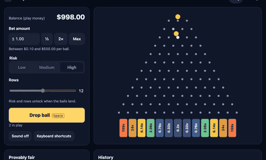
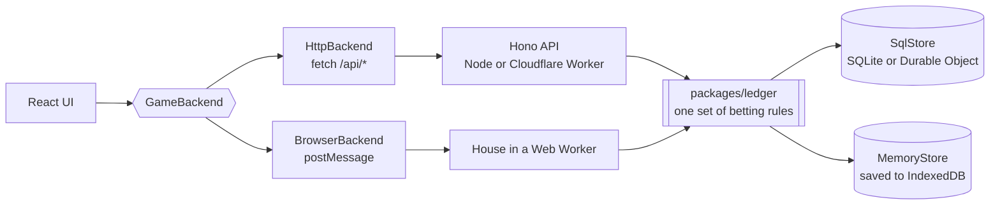
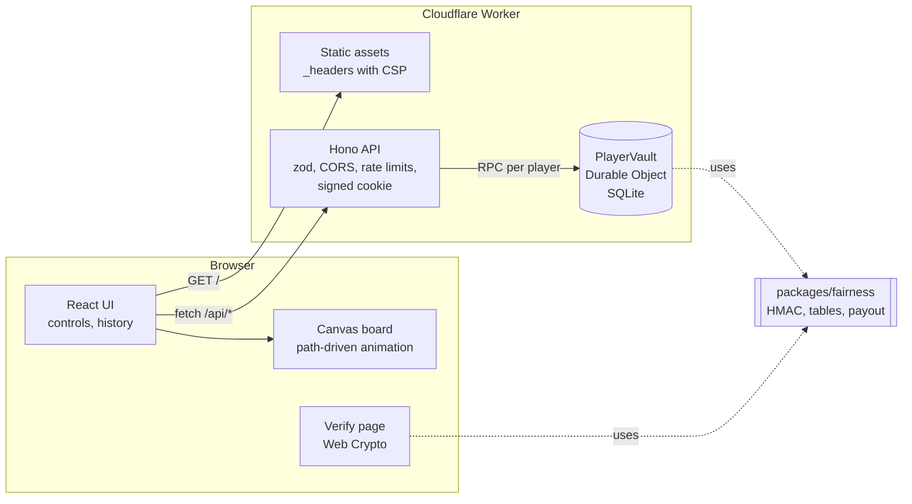
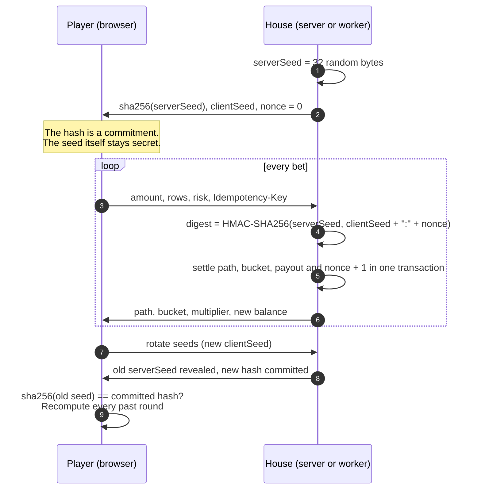
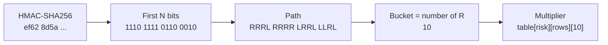
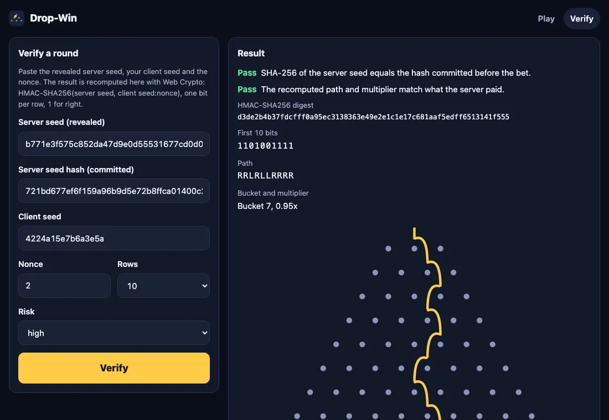

# Drop-Win

A provably fair ball-drop game where every result is committed before you bet and can be re-checked in your browser.



**Live demo:** [shashank11yadav.github.io/Drop-Win](https://shashank11yadav.github.io/Drop-Win/). This is browser mode: the house runs in a Web Worker in your tab, so the demo shows how commit-reveal works but cannot keep the seed from you or stop a dishonest house. [Two modes](#two-modes) explains the difference, and the server version [runs locally](#server-mode-with-node) with `npm run dev`.

More of my projects: [shashankyadav.dev](https://www.shashankyadav.dev/#work)

**Play money only.** Balances are pretend dollars with no value. There are no deposits, withdrawals, payments, real-money or crypto features, and none are planned.

## Contents

- [Two modes](#two-modes)
- [How it works](#how-it-works)
- [The math](#the-math)
- [Verify a round yourself](#verify-a-round-yourself)
- [Design decisions](#design-decisions)
- [Security notes](#security-notes)
- [Running locally](#running-locally)
- [Testing](#testing)
- [Deploy](#deploy)
- [Project structure](#project-structure)
- [Limitations and next steps](#limitations-and-next-steps)
- [Credits](#credits)
- [License](#license)

## Two modes

The same game, fairness protocol, ledger rules, history and verifier run in both modes. Only the place where the house lives changes.

|                          | Browser mode (the live demo)                                                                                                                     | Server mode                                                                                                                     |
| ------------------------ | ------------------------------------------------------------------------------------------------------------------------------------------------ | ------------------------------------------------------------------------------------------------------------------------------- |
| Where the house runs     | A Web Worker in your tab                                                                                                                         | A Hono API on Node, or a Cloudflare Worker with one Durable Object per player                                                   |
| Where the server seed is | In the worker's memory and in your browser's IndexedDB                                                                                           | In SQLite on the server. Only its SHA-256 hash reaches the browser until you rotate                                             |
| Trust model              | Shows how commit-reveal works. You can read the seed before betting, and the house is code the page shipped, so it cannot stop a dishonest house | The seed is out of the player's reach until it is revealed, and the commitment stops the server changing results after the fact |
| Persistence              | IndexedDB in this browser, checked on every load. **Reset demo** wipes it                                                                        | SQLite file (Node) or Durable Object storage (Worker), found through an anonymous signed cookie                                 |
| Hosting                  | Static files on GitHub Pages. No server, no network requests after the page loads                                                                | One Node process, or one Worker on Cloudflare's free plan                                                                       |

Commit-reveal protects each side from the other. In server mode the house holds the server seed and you hold your client seed, and neither can steer an outcome alone. In browser mode both secrets sit on your machine: devtools or an extension can read the active server seed, and a modified copy of the page could show one hash while betting with another seed. Checking a revealed round with an independent tool (see [Verify a round yourself](#verify-a-round-yourself)) would still catch that, but nothing in browser mode keeps the house's secret from you or keeps the house honest. That is why the live page carries a banner saying so.

### One interface, two backends



The web app only talks to `GameBackend` (session, state, history, bet, rotate seed, refill). The backend is picked at build time: `VITE_BACKEND=browser` (or the `browser` and `pages` Vite modes) selects the worker, anything else selects the API. Both houses run the same `Ledger` class, validate requests with the same zod schemas, and return the same error codes and messages, and a parity test holds them to identical results.

## How it works

The house decides each drop with a keyed hash of secrets it committed to earlier. The browser receives the left/right path and animates the ball along exactly that path, so the picture and the payout always agree.

### Server mode architecture



One Worker serves both the built web app and `/api/*`. Each player is a Durable Object with its own SQLite database. The same Hono app and ledger also run on plain Node with `node:sqlite`, which is what local development, the tests and the server-mode end-to-end suite use.

In browser mode the `CF` box is replaced by a Web Worker in the tab running the same ledger on an in-memory store, and the page is plain static files.

### Commit and reveal



The house cannot change the outcome after the fact, because the seed was fixed by its hash before the first bet. It cannot pick a seed that suits your bets either, because the result also depends on your client seed, which you can set to anything when rotating. In browser mode the second half of the "seed stays secret" note does not hold, as described in [Two modes](#two-modes).

### From digest to bucket



Bits are read most significant first within each byte, one per row. A `1` bounces right and a `0` bounces left. After `N` rows the ball sits in bucket `k`, the count of right bounces, from `0` (far left) to `N` (far right). Changing the row count only changes how many bits are read.

The animation is not a physics simulation. Given the path, the ball falls onto the top of exactly one peg per row (the peg at index `rights + 1` in that row), hops half a peg spacing left or right on a parabola with an eased sideways kick, and comes to rest in the bucket. Tests check that all 256 eight-row paths and 1,500 random 9- to 16-row paths land in the bucket the house named, that the ball touches the right peg on every row, and that sampled trajectories never pass through a peg.

## The math

### Bucket probabilities

Each row is an independent fair coin, so the bucket follows a binomial distribution:

$$P(k) = \binom{N}{k} \Big/ 2^N, \qquad k = 0, \dots, N,\quad N \in \{8, \dots, 16\}$$

### Multiplier tables

Every table is built from one formula with two knobs per risk level:

$$m_k = f + b\left(P(k)^{-\alpha} - P_{\max}^{-\alpha}\right)$$

- `f` (the floor) is what the most likely bucket pays.
- `α` (the tail) controls how much rarity is rewarded. With `α = 1` every bucket would contribute equally to the expected return.
- `b` is solved in closed form so that the expected return hits the target exactly:

$$\sum_k P(k)\, m_k = \text{RTP} \;\Rightarrow\; b = \frac{\text{RTP} - f}{\sum_k P(k)\left(P(k)^{-\alpha} - P_{\max}^{-\alpha}\right)}$$

| Risk   | Floor `f` | Tail `α` | 8 rows edge | 16 rows edge | 16-row centre |
| ------ | --------- | -------- | ----------- | ------------ | ------------- |
| Low    | 0.5x      | 0.40     | 8.94x       | 76.7x        | 0.5x          |
| Medium | 0.3x      | 0.60     | 17.3x       | 373x         | 0.3x          |
| High   | 0.2x      | 0.75     | 25.2x       | 1085x        | 0.2x          |

The target RTP (return to player) is 99%. The ideal values are then rounded to what a player expects to read: hundredths below 10x, tenths below 100x, whole numbers above. Rounding pushes the RTP slightly off target, so a small exhaustive search nudges the four rings of buckets nearest the centre (they hold most of the probability) by a few display steps and keeps the table closest to 99% that is still symmetric and rises toward the edges.

`packages/fairness/scripts/tables.ts` generates `tables.generated.ts` and fails if any table is off target or if the committed file is stale. RTP is computed exactly with integers: `sum(C(N,k) * m_k) / (100 * 2^N)`, with multipliers stored in hundredths.

**Result:** all 27 tables (9 row counts by 3 risks) are within 0.0088 percentage points of 99%. The test tolerance is 0.01 points. Higher risk has strictly higher variance at every row count, which is also tested.

### Does the RNG really produce that distribution?

A test drops 100,000 balls with fixed seeds through the real derivation and runs Pearson's chi-square test against the binomial distribution (edge buckets pooled until every group expects at least 5 hits):

| Rows | χ²    | Degrees of freedom | Critical value (p = 0.001) | p-value |
| ---- | ----- | ------------------ | -------------------------- | ------- |
| 8    | 7.51  | 8                  | 26.12                      | 0.48    |
| 16   | 17.37 | 14                 | 36.12                      | 0.24    |

The seeds are fixed so the test can never flake. `node packages/fairness/scripts/simulate.ts` repeats this for every row count with a fresh random seed and also prints simulated RTP next to the exact figure. Simulated RTP at 16 rows and high risk wanders by a couple of points over 100k drops, which is expected when one bucket in 65,536 pays 1085x.

### Money

All balances and bets are integer cents. Multipliers are integer hundredths. A payout is `floor(amountCents * multiplierHundredths / 100)`, the only rounding step, and it always rounds in the house's favour by less than one cent. The bet input is parsed with string arithmetic so `0.1 + 0.2` style float errors cannot appear.

## Verify a round yourself

**In the app.** Open the history, click **Reveal and rotate seeds**, then click **Verify** on any earlier bet. The verify page recomputes the round with your browser's Web Crypto, checks that `sha256(serverSeed)` equals the hash you were shown before betting, and confirms the path and multiplier match what was paid. Nothing is sent anywhere, the page works for any values you paste in, and it is the same page in both modes.



**Without this code.** Any HMAC tool gives the same answer. With the server seed, client seed and nonce from a revealed bet:

```sh
SERVER_SEED=a3f1c5e9d2b8470e96c3f0a1b2d4e6f8091a2b3c4d5e6f708192a3b4c5d6e7f8
CLIENT_SEED=player-seed
NONCE=0

# 1. The seed matches the commitment you saw before betting
printf '%s' "$SERVER_SEED" | shasum -a 256
# 614f4563ca0b64da228859760dbf293416d20592ae5f5582012f83eb78cad6ad

# 2. The round's digest
printf '%s' "$CLIENT_SEED:$NONCE" | openssl dgst -sha256 -hmac "$SERVER_SEED"
# ef628d5ae6bdb951de0b2596bb5d9dd669b86feb0f30eba43a42ae8d6310f6e7
```

`ef 62` in binary is `11101111 01100010`. For 16 rows that is the path `RRRLRRRRLRRLLLRL`, ten right bounces, bucket 10, which pays 0.68x at medium risk. These exact values are a test vector in `packages/fairness/test/outcome.test.ts`.

## Design decisions

**Path-driven animation instead of physics.** The old version simulated physics and looked up which starting position would probably reach the chosen bucket. After the physics constants changed, only about one ball in ten landed where the server said. Here the house's bits are the path, and the animation is a pure function of `(path, elapsed time, board width)`. There is nothing to drift out of sync, resizing mid-drop is harmless, and reduced motion is just "elapsed = end".

**Cloudflare Workers and Durable Objects over Node plus a hosted database.** A Durable Object gives each player a single-threaded actor with its own SQLite database, which is exactly the consistency model a balance needs, and it is available on the Workers free plan. Hosting the web app as static assets on the same Worker keeps the session cookie first-party, which avoids third-party cookie blocking and allows `SameSite=Strict`.

**One ledger, three runtimes.** The betting rules live in `packages/ledger` and talk to a small synchronous `LedgerStore` interface. `SqlStore` implements it on SQLite for `node:sqlite` and Durable Objects; `MemoryStore` implements it in plain objects for the browser, with the same CHECK and UNIQUE rules as the schema and an undo log so a failed bet leaves nothing behind. The ledger tests run against both stores. Writing a second ledger for the browser would have been quicker, and the two would have drifted apart.

**The browser house runs in a Web Worker.** It keeps the active seed in a separate JavaScript context from the UI, so the page only ever sees what the API would send, and the UI code is the same in both modes. A worker is also where IndexedDB is available and localStorage is not. This is a code boundary, not a security boundary: the person at the keyboard can read anything in their own browser.

**Each ledger commit is one IndexedDB transaction, and the reply waits for it.** A crash or closed tab leaves the last complete bet saved, never half of one. On load the save is parsed with zod, every seed is checked against its hash, and cross-record rules are re-checked (one unrevealed seed, nonces issued by their seed, no duplicate keys). A save that fails any check is discarded and a fresh demo starts with a notice, rather than half-loading. A Web Lock keeps a second tab from writing over the first tab's save; the second tab plays in memory and says so.

**Bets are serialized per player, then settled in one transaction.** The HMAC uses async Web Crypto, so two concurrent requests could both read nonce N. Each player's bets go through an in-memory queue (exact in a Durable Object, which runs one instance per player, and in the browser worker), then the debit, credit, nonce increment and history row are written in a single transaction that re-checks the nonce. Storage refuses a negative balance even if application code were wrong. A test fires 30 concurrent bets and checks the nonces are exactly 0 to 29.

**Idempotency keys.** Every bet carries a UUID idempotency key. The client retries once on a dropped connection or a busy house with the same key, and the house replays the stored result instead of charging twice. Reusing a key for a different bet is a 409.

**Shared fairness package.** `packages/fairness` holds the outcome derivation and tables, and is imported by both houses and the verifier page. The verifier is still an independent check of the house's honesty because it recomputes from public inputs. Web Crypto results are tested against Node's `crypto` module and against openssl test vectors.

**Displayed balance lags the house on purpose.** The house's balance already includes the payout of a ball that is still falling. The UI subtracts in-flight payouts so the number only moves when a ball lands, and ignores late responses that would roll the balance back.

**React, no router, no CSS framework.** Two pages do not need a router, so routing is a hash listener and a switch, which also means GitHub Pages needs no 404 trick. Plain CSS with custom properties covers dark and light themes. The server-mode bundle is 88.6 KB of gzipped JavaScript. The Pages build is 91.7 KB for the page plus 14 KB for the worker, which carries its own copy of zod and the ledger.

**TypeScript 6.0 rather than 7.** TypeScript 7 (the native compiler) is out, but typescript-eslint's type-aware rules only support up to 6.0, and those rules are worth more here than a faster compiler.

## Security notes

- **Seeds.** Server seeds are 32 bytes from the platform CSPRNG (`crypto.getRandomValues`, in Node, Workers and the browser worker alike). The active seed is never sent to the UI; only its SHA-256 hash is. Tests check that the active seed appears in no state, bet or history response in either mode.
- **Validation at every boundary.** Request bodies, the `Idempotency-Key` header, query strings, the session cookie value, environment variables, verify-page URL parameters, messages to and from the browser house, and the IndexedDB save are parsed with zod. Request schemas are strict, so a client-supplied field like `multiplier` is rejected rather than ignored. The web client also parses every response from either house.
- **Sessions (server mode).** An anonymous random UUID in an HMAC-signed, `HttpOnly`, `SameSite=Strict` cookie, `Secure` with the `__Host-` prefix in production. Signing means a forged id is rejected before any storage is touched, which also stops anyone spinning up arbitrary Durable Objects.
- **CSRF and CORS (server mode).** POST requests must be `application/json` (a cross-site form cannot send that without a preflight) and must come from the same origin or a configured one. CORS answers only configured origins.
- **Rate limits and size limits (server mode).** Per-IP limits for all API calls and for new sessions, a per-player limit on bets, and a 2 KB body limit. Node uses an in-memory fixed window with bounded memory; the Worker uses Cloudflare's rate limiting binding with the same numbers (a test checks they match). Browser mode has no shared resource to protect, so it has no rate limits.
- **Headers in server mode.** The web app ships a strict CSP (`script-src 'self'`, no inline scripts or styles, `frame-ancestors 'none'`), HSTS, `nosniff`, `Referrer-Policy: no-referrer` and a restrictive `Permissions-Policy`. The end-to-end test runs under that policy and fails on any console error. API responses carry `default-src 'none'` and `Cache-Control: no-store`.
- **Policy on GitHub Pages.** Pages cannot send headers, so the Pages build puts its CSP in a `<meta>` tag right after the charset and before any script: `default-src 'self'`, `script-src 'self'`, `style-src 'self'` (no inline scripts or styles), `connect-src 'self'`, `worker-src 'self'`, `object-src 'none'`, `base-uri 'self'`, `form-action 'none'`, plus a `no-referrer` meta tag. A meta CSP cannot carry `frame-ancestors`, and there is no way to send `X-Frame-Options`, `nosniff` or HSTS there, so the demo can be framed by another site. The house worker gets no policy of its own there either, because a worker's CSP comes from its own response headers; it is one bundled file that imports nothing and makes no requests. The page makes no network requests after loading its own files; the Pages end-to-end test fails on any request outside `/Drop-Win/`, any console error and any CSP violation event.
- **Errors.** Unexpected errors return a generic message; details go to server logs only.
- **Supply chain.** Dependencies are pinned, `npm audit --omit=dev` runs in CI, CodeQL scans on every push and weekly, Dependabot updates npm packages and GitHub Actions, and all actions are pinned to full commit SHAs. Workflows default to `contents: read`; only the Pages deploy job gets `pages: write` and `id-token: write`.

See [SECURITY.md](SECURITY.md) for how to report a problem.

## Running locally

Requires Node 24 or newer.

```sh
git clone https://github.com/shashank11yadav/Drop-Win.git
cd Drop-Win
npm ci
```

### Browser mode (what the live demo runs)

```sh
npm run dev:browser
```

Open http://localhost:5310. Vite serves the app and the house runs in a Web Worker in the tab; nothing else is started. To try the exact files GitHub Pages serves, under the same `/Drop-Win/` path and with the meta-tag CSP:

```sh
npm run build:pages
npm run preview:pages
```

Then open http://localhost:5310/Drop-Win/.

### Server mode with Node

```sh
npm run dev
```

Open http://localhost:5300. This starts the API on port 5301 (Node, SQLite file in `apps/api/data/`) and Vite on 5300, which proxies `/api` to it. Without a `.env` the API generates a throwaway session secret; to keep sessions across restarts, `cp .env.example .env` and set `SESSION_SECRET` (`openssl rand -hex 32`). Set `WEB_PORT` and `API_PORT` to use other ports.

### Server mode on the Cloudflare Worker, locally

```sh
npm run build -w @drop-win/web
npm run dev:worker -w @drop-win/api
```

Open http://localhost:5302. This is `wrangler dev`: the real Worker, Durable Object and SQLite storage running in workerd on your machine, serving the built web app as static assets. No Cloudflare account is needed for local runs.

### Other commands

| Command                                      | What it does                                                                |
| -------------------------------------------- | --------------------------------------------------------------------------- |
| `npm start`                                  | Builds the web app and serves it and the API from one Node process on 5301. |
| `npm run build`                              | Builds the web app and bundles the Worker (`wrangler deploy --dry-run`).    |
| `npm run build:pages`                        | Builds browser mode for GitHub Pages into `apps/web/dist-pages`.            |
| `node packages/fairness/scripts/simulate.ts` | Prints chi-square and simulated RTP for every row count.                    |
| `npm run tables -w @drop-win/fairness`       | Regenerates the multiplier tables.                                          |

All environment variables are documented in [.env.example](.env.example).

## Testing

```sh
npm run lint          # ESLint (strict type-checked rules) and Prettier
npm run typecheck     # tsc for every workspace, including the Worker
npm test              # Vitest: fairness, contract, ledger, API, web and parity
npm run tables:check  # tables match the generator and the RTP target
npm run e2e           # Playwright on server mode, desktop and phone
npm run e2e:pages     # Playwright on the Pages build, desktop and phone
```

What the 320 unit and integration tests cover:

- **Fairness:** openssl test vectors, Web Crypto against `node:crypto` on 500 random inputs, bit order, input validation, chi-square over 100k drops, RTP of every table, table shape, and that the committed tables match the generator.
- **Ledger:** every ledger rule run against both SQLite and the in-memory store: balance never negative under concurrency, nonce increments once per bet, idempotent replay and key reuse, rotation reveals the committed seed and every past round verifies, the active seed stays hidden. The memory store's rollback and constraints, and a restore that rejects 15 kinds of tampered save (bad shape, negative or fractional balance, a seed that does not match its hash, two or zero active seeds, foreign or duplicate nonces and ids, a path that disagrees with its bucket, an oversized bet).
- **API:** invalid bets rejected (zero, negative, fractional, too large, wrong types, unknown fields, bad rows or risk), cookie tampering, CORS and origin checks, content type and body size, rate limits, security headers, and hidden internal errors.
- **Browser house:** the same ledger rules through a real `MessageChannel`, request validation matching the API, malformed messages, reload from storage, a tampered save replaced by a fresh demo with a notice, storage failures falling back to memory, and reset.
- **Parity:** the HTTP API (Hono on `node:sqlite`) and the browser house are driven through the same 56-step script with the same seed source and clock: 45 bets over every row count and risk, a retried key, a reused key, a zero bet, a refused refill, two history pages and two rotations. Every result, error and reveal must be identical. A control run with different seeds must differ.
- **Web:** every 8-row path lands in the right bucket, peg contact and clearance, layout at 343 px, money parsing, verify-link parsing (including hostile input), the game state reducer, and WCAG contrast for every theme token and bucket label colour.
- **End to end, server mode:** place a bet, rotate, open the verify link, see both checks pass, then tamper with the seed and see the hash check fail. A second test drops a ball with the Space key under reduced motion. Both run on a desktop and a phone viewport against the production build and CSP.
- **End to end, Pages build:** served under `/Drop-Win/` with no headers. Bets, rotation and a passing verification, then a tampered seed that fails; a reload that keeps the demo and a reset that clears it; a hand-edited IndexedDB save that is rejected; a second tab that plays without saving; an axe scan of both pages; and a 375 px screen with no sideways scrolling. Any console error, CSP violation or request outside the page's own folder fails the run.

## Deploy

### Live demo on GitHub Pages (browser mode)

`.github/workflows/pages.yml` runs on every push to `master` and on manual dispatch. It runs the unit tests and the Pages end-to-end suite, then uploads `apps/web/dist-pages` and deploys it. To turn it on in a fork, set **Settings > Pages > Source** to **GitHub Actions**. If the repository is not called `Drop-Win`, change `base` in `apps/web/vite.config.ts` to match.

### Server mode deploy (optional, Cloudflare free plan)

A single Cloudflare Worker on the free plan: static assets for the web app, the API, and a SQLite-backed Durable Object per player.

```sh
npx wrangler login
npm run build -w @drop-win/web
cd apps/api
npx wrangler secret put SESSION_SECRET   # paste the output of: openssl rand -hex 32
npx wrangler deploy
```

Wrangler prints the `*.workers.dev` URL. Configuration lives in `apps/api/wrangler.jsonc`:

| Variable          | Where        | Notes                                                                   |
| ----------------- | ------------ | ----------------------------------------------------------------------- |
| `SESSION_SECRET`  | Secret       | Required in production, 32+ characters.                                 |
| `APP_ENV`         | `vars`       | `production` turns on Secure `__Host-` cookies and requires the secret. |
| `ALLOWED_ORIGINS` | `vars`       | Leave empty when the web app is served by the same Worker.              |
| `COOKIE_SAMESITE` | `vars`       | `Strict` for the same-origin deploy.                                    |
| Rate limits       | `ratelimits` | `namespace_id` values only need to be unique in your account.           |

**Hosting the server-mode web app elsewhere** (Vercel, Cloudflare Pages): build with `VITE_API_BASE=https://your-worker.workers.dev`, set `ALLOWED_ORIGINS` to the web app's origin and `COOKIE_SAMESITE=None` on the Worker. The build adds the API origin to the CSP `connect-src`. Browsers that block third-party cookies (Safari, Firefox in strict mode) will not keep the session, which is why the single-Worker deploy is the recommended one.

**Self-hosting on Node:** `APP_ENV=production SESSION_SECRET=... npm start` behind an HTTPS reverse proxy, with `TRUST_PROXY=true` only if the proxy overwrites `X-Forwarded-For`.

## Project structure

```
apps/
  api/
    src/
      app.ts            Hono routes and middleware (validation, CORS, CSRF, limits, sessions)
      sql-store.ts      the ledger's storage on SQLite
      schema.ts         SQLite tables and constraints
      config.ts         environment parsing
      rate-limit.ts     in-memory limiter for Node
      node.ts           Node entry (node:sqlite, optional static hosting)
    worker/
      index.ts          Worker entry, rate limiting binding, Durable Object routing
      player-vault.ts   Durable Object: one ledger per player
    test/               ledger (on both stores), HTTP API, config and wrangler.jsonc tests
    wrangler.jsonc
  web/
    src/
      backend/          GameBackend interface, HttpBackend, BrowserBackend
      house/            the browser house: worker entry, message protocol, IndexedDB storage
      board/            geometry, trajectory, renderer, palette, Board component
      game/             play page, controls, fairness panel, history, state reducer
      verify/           verify page
      lib/              money, hash routing, sound, preferences
    test/
packages/
  fairness/             HMAC derivation, binomial math, multiplier tables, generator and simulator scripts
  contract/             zod schemas, limits and security headers shared by every part
  ledger/               betting rules, LedgerStore interface, in-memory store and validated restore
test/                   parity test: HTTP API against the browser house
e2e/                    Playwright tests for server mode
e2e-pages/              Playwright tests for the Pages build
docs/                   README media
```

## Limitations and next steps

- **Browser mode is a demonstration.** The player can read the active server seed, and the house is code the page shipped. See [Two modes](#two-modes).
- **No framing protection on GitHub Pages.** A meta-tag CSP cannot set `frame-ancestors`, and Pages cannot send headers. Server mode sends `frame-ancestors 'none'` and `X-Frame-Options: DENY`.
- **Browser-mode saves stay in one browser.** Clearing site data, a private window or a second tab starts a separate demo.
- **Anonymous sessions only in server mode.** Clearing cookies loses the balance. Since nothing has value, accounts would add risk without benefit.
- **Rows and risk are locked while balls are in flight.** This keeps the board's geometry consistent with every ball on it. Mixed boards would need one canvas per configuration.
- **Rate limits on Workers are per Cloudflare location** and approximate, which is how the binding works. The Durable Object queue still serializes each player's bets exactly.
- **No server-side auto-bet or bet history export.** Both would be straightforward on top of the ledger.
- **The verify page trusts the bundled multiplier tables.** A fully independent verifier would also recompute the tables from the formula; the generator script does this, but the page does not.
- **React is most of the bundle.** Swapping in Preact would remove most of the 88 KB if size became important.

## Credits

- Started as a learning project based on the 100xdevs [plinkoo](https://github.com/code100x/plinkoo) tutorial; this version is a ground-up rewrite with no code carried over.
- The commit-reveal scheme with a server seed, client seed and nonce is the standard approach used across provably fair games; the multiplier formula, tables and code here are my own.
- Built with [Hono](https://hono.dev), [zod](https://zod.dev), [React](https://react.dev), [Vite](https://vite.dev), [Cloudflare Workers and Durable Objects](https://developers.cloudflare.com/durable-objects/), [Vitest](https://vitest.dev), [Playwright](https://playwright.dev) and [axe-core](https://github.com/dequelabs/axe-core).

## License

[MIT](LICENSE), copyright (c) 2026 Shashank Yadav.
